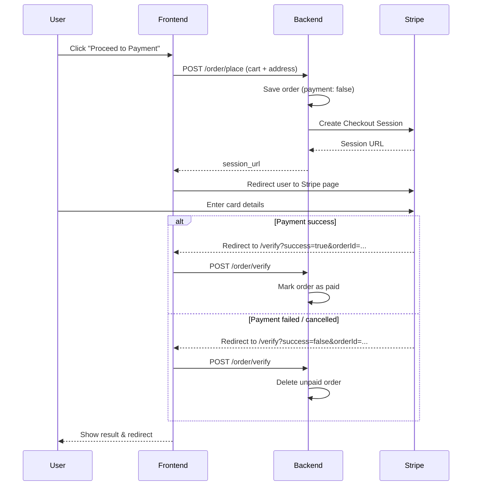

<div align="center">

# 🍔 NukkadEats

### Fresh food from your neighbourhood *nukkad*, delivered to your door.

A full-stack food delivery web application built with the **MERN stack** and **Stripe** payments.


[Live Demos](#-live-demos) • [Features](#-features) • [Tech Stack](#-tech-stack) • [Getting Started](#-getting-started) • [API Reference](#-api-reference) • [Payment Flow](#-stripe-payment-flow) • [Contributing](#-contributing)

</div>

---

## 🌐 Live Demos

- 🛒 **Customer Frontend Website**: [https://food-delivery-eosin-theta.vercel.app/](https://food-delivery-eosin-theta.vercel.app/)
- 🛠️ **Admin Dashboard**: [https://food-delivery-oo3f.vercel.app/orders](https://food-delivery-oo3f.vercel.app/orders)

---

## 📖 Table of Contents

- [About](#-about)
- [Live Demos](#-live-demos)
- [Features](#-features)
- [Tech Stack](#-tech-stack)
- [Project Structure](#-project-structure)
- [Getting Started](#-getting-started)
- [Environment Variables](#-environment-variables)
- [API Reference](#-api-reference)
- [Stripe Payment Flow](#-stripe-payment-flow)
- [Screenshots](#-screenshots)
- [Roadmap](#-roadmap)
- [Contributing](#-contributing)
- [License](#-license)
- [Author](#-author)

---

## 📌 About

**NukkadEats** lets customers browse a menu, build a cart, place an order with delivery details, and pay securely online through Stripe Checkout. A separate **admin panel** lets restaurant staff manage the menu and track orders.

The project is split into three independent apps — a customer storefront, an admin dashboard, and a REST API — so each can be developed, deployed, and scaled on its own.

---

## 🚀 Features

### 👤 Customer Features
- 🔐 User registration & login with **JWT authentication**
- 🍕 Browse food items by category, with images
- 🛒 Add / remove items from the cart, with live quantity updates
- 🧾 View cart summary with item totals and delivery fee
- 📦 Place orders with delivery address details
- 💳 Secure online payment via **Stripe Checkout**
- 📜 View order history and current order status

### 🛠️ Admin Features
- ➕ Add new food items with image upload
- 📋 View and remove existing items
- 📬 View all customer orders
- 🔄 Update order status (e.g. *Food Processing → Out for Delivery → Delivered*)

### ⚙️ Backend Features
- RESTful API design
- MongoDB + Mongoose schemas for users, foods, carts & orders
- JWT-protected routes via auth middleware
- Stripe Checkout session creation & payment verification
- Image upload with **Multer** and static file serving
- Password hashing and input validation

---

## 🧑‍💻 Tech Stack

| Layer | Technologies |
|-------|--------------|
| **Frontend (Customer)** | React.js (Vite), React Router, Context API, Axios, React Toastify |
| **Admin Panel** | React.js (Vite), React Router, Axios, React Toastify |
| **Backend** | Node.js, Express.js |
| **Database** | MongoDB, Mongoose |
| **Auth** | JSON Web Tokens (JWT), bcrypt |
| **Payments** | Stripe API (Checkout Sessions) |
| **File Uploads** | Multer |

---

## 📂 Project Structure

```
food-del/
│
├── frontend/                # Customer-facing web app (Vite + React)
│   ├── src/
│   │   ├── components/      # Reusable UI components
│   │   ├── pages/           # Home, Cart, PlaceOrder, MyOrders, Verify
│   │   ├── context/         # Global state (StoreContext)
│   │   └── assets/          # Images & icons
│   └── package.json
│
├── admin/                   # Admin panel (Vite + React)
│   ├── src/
│   │   ├── components/      # Navbar, Sidebar
│   │   └── pages/           # Add, List, Orders
│   └── package.json
│
├── backend/                 # Express API server
│   ├── config/              # Database connection
│   ├── controllers/         # Request handlers
│   ├── middleware/          # JWT auth middleware
│   ├── models/              # Mongoose models
│   ├── routes/              # API routes
│   ├── uploads/             # Uploaded food images
│   ├── server.js            # Entry point
│   └── package.json
│
└── README.md
```

---

## 🏁 Getting Started

### Prerequisites

Make sure you have the following installed:

- [Node.js](https://nodejs.org/) v18 or higher
- [npm](https://www.npmjs.com/) or [yarn](https://yarnpkg.com/)
- A [MongoDB](https://www.mongodb.com/) database (local or [Atlas](https://www.mongodb.com/atlas))
- A [Stripe](https://stripe.com/) account (test mode keys are fine)

### 1. Clone the repository

```bash
git clone https://github.com/<your-username>/food-del.git
cd food-del
```

### 2. Set up the backend

```bash
cd backend
npm install
```

Create a `.env` file in `backend/` (see [Environment Variables](#-environment-variables)), then start the server:

```bash
npm run server
```

The API runs at **http://localhost:4000**.

### 3. Set up the customer frontend

```bash
cd ../frontend
npm install
npm run dev
```

The storefront runs at **http://localhost:5173**.

### 4. Set up the admin panel

```bash
cd ../admin
npm install
npm run dev
```

The admin panel runs at **http://localhost:5174**.

> 💡 **Tip:** Open three terminals and run all three apps at the same time.

---

## 🔑 Environment Variables

### `backend/.env`

```env
# Server
PORT=4000

# Database
MONGO_URI=mongodb+srv://<username>:<password>@<cluster>.mongodb.net/nukkadeats

# Auth
JWT_SECRET=your_super_secret_key

# Stripe
STRIPE_SECRET_KEY=sk_test_...

# Frontend URL (used for Stripe success/cancel redirects)
FRONTEND_URL=https://food-delivery-eosin-theta.vercel.app
```

### `frontend/.env`

```env
# Backend API Base URL
VITE_API_URL=http://localhost:4000

# Admin Portal URL
VITE_ADMIN_URL=https://food-delivery-oo3f.vercel.app/orders
```

### `admin/.env`

```env
# Backend API Base URL
VITE_API_URL=http://localhost:4000

# Customer Website URL
VITE_FRONTEND_URL=https://food-delivery-eosin-theta.vercel.app
```

> ⚠️ **Never commit your `.env` file.** Make sure it is listed in `.gitignore`.

---

## 📡 API Reference

Base URL: `http://localhost:4000/api`

🔒 = requires `token` header (JWT)

### Auth

| Method | Endpoint | Description |
|--------|----------|-------------|
| `POST` | `/user/register` | Register a new user |
| `POST` | `/user/login` | Log in and receive a JWT |

### Food

| Method | Endpoint | Description |
|--------|----------|-------------|
| `GET` | `/food/list` | Get all food items |
| `POST` | `/food/add` | Add a food item (multipart/form-data with image) |
| `POST` | `/food/remove` | Remove a food item |

### Cart

| Method | Endpoint | Description |
|--------|----------|-------------|
| `POST` | `/cart/add` 🔒 | Add an item to the cart |
| `POST` | `/cart/remove` 🔒 | Remove an item from the cart |
| `POST` | `/cart/get` 🔒 | Get the user's cart |

### Orders

| Method | Endpoint | Description |
|--------|----------|-------------|
| `POST` | `/order/place` 🔒 | Create an order and Stripe Checkout session |
| `POST` | `/order/verify` | Verify payment result after Stripe redirect |
| `POST` | `/order/userorders` 🔒 | Get the logged-in user's orders |
| `GET` | `/order/list` | Get all orders (admin) |
| `POST` | `/order/status` | Update order status (admin) |

> 📝 Endpoint names above follow common conventions — adjust them to match your actual route files.

---

## 💳 Stripe Payment Flow



**In short:**

1. User clicks **Proceed to Payment**
2. Backend creates a **Stripe Checkout Session**
3. User is redirected to the **Stripe payment page**
4. On success or failure, Stripe redirects back to the frontend, which verifies the result with the backend

### 🧪 Testing payments

Use Stripe's test card in test mode:

| Field | Value |
|-------|-------|
| Card number | `4242 4242 4242 4242` |
| Expiry | Any future date |
| CVC | Any 3 digits |
| ZIP | Any 5 digits |

---

## 🗺️ Roadmap

- [ ] Admin authentication & role-based access
- [ ] Search and filter food items
- [ ] Ratings & reviews
- [ ] Coupon / promo codes
- [ ] Stripe webhooks for more reliable payment confirmation
- [ ] Email / SMS order notifications
- [ ] Real-time order tracking
- [ ] Deployment guides (Vercel, Render, Railway)

---

## 🤝 Contributing

Contributions, issues, and feature requests are welcome!

1. Fork the repository
2. Create your feature branch: `git checkout -b feature/amazing-feature`
3. Commit your changes: `git commit -m "Add amazing feature"`
4. Push to the branch: `git push origin feature/amazing-feature`
5. Open a Pull Request

---

## 📄 License

This project is licensed under the **MIT License** — see the [LICENSE](LICENSE) file for details.


<div align="center">

⭐ If you found this project helpful, please consider giving it a star!

Made with ❤️ and lots of ☕

</div>
